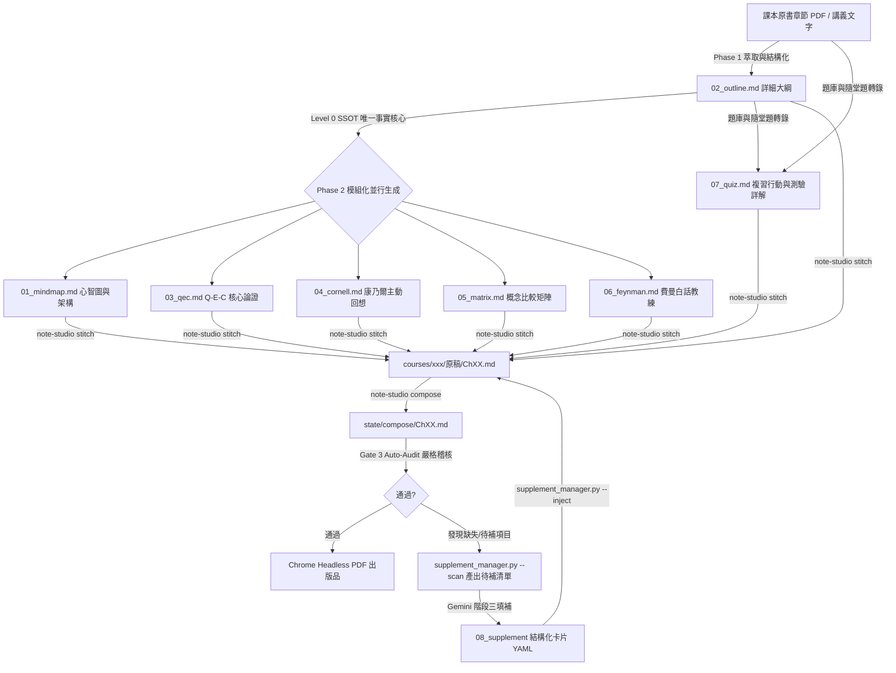

# 模組化學習筆記生成規格手冊（Modular Note Generation Handbook）

> **專為 Gemini / AI 模型設計之出版級學習筆記全自動生成規範**  
> 本手冊依據 `note-studio` 專案之 **SPEC-017 模組化筆記解耦規格** 與 **Argon 認知筆記模式** 提煉而成，結合語意標籤體系、排版防錯規範與零刪字稽核（Gate 3 Auto-Audit）。供日後生成其他科目、章節或跨領域教材時遵循。

---

## 1. 系統架構與兩階段生成流水線（Two-Phase Protocol）

為了避免大模型單次輸出長度受限、產生幻覺或發生前後章節邏輯矛盾，生成流程嚴格劃分為兩階段：



### 階段一：Level 0 SSOT 核心確立（Outline First）
- 必須先根據教材原文產出 `02_outline.md`。
- `02_outline.md` 是全章所有後續模組（心智圖、QEC、康乃爾、矩陣、費曼）的**單一事實來源（Single Source of Truth, SSOT）**。
- 所有概念名詞、學者年代、引註章節代號一律以 `02_outline.md` 為準。

### 階段二：各模組逐步生成
- 同一個 Gemini 對話內依序生成模組一到七。每一步程式讀取對應的規格檔，取出「## Gemini 提示詞」區塊、填入科目與章節後送出（`src/note_studio/services/generator/module_prompts.py`）。
- **這七份檔案就是送給 Gemini 的 prompt，是唯一來源**；要調整某一種筆記的要求，直接改該檔案的提示詞區塊：
  - [01_mindmap_spec.md](01_mindmap_spec.md)：心智圖與章節架構
  - [02_outline_spec.md](02_outline_spec.md)：詳細階層筆記（全章唯一事實來源）
  - [03_qec_spec.md](03_qec_spec.md)：Q-E-C 核心論證
  - [04_cornell_spec.md](04_cornell_spec.md)：康乃爾筆記
  - [05_matrix_spec.md](05_matrix_spec.md)：比較矩陣
  - [06_feynman_spec.md](06_feynman_spec.md)：費曼白話教練
  - [07_quiz_spec.md](07_quiz_spec.md)：複習行動與課本題目
- 上傳給 Gemini 的排版手冊另含 `docs/specs/002-note-format.md` §4.1 的重點摘要；兩邊數字必須一致。

### 階段三：稽核缺失填補與課外經典補充（Audit Gap-Filling & Supplements）
- 當稽核掃描出缺漏（如：課本一句帶過的經典實驗、未中文化的學習目標、題庫只有答案缺少誘答分析）時，進入缺失填補工作流：
  - [08_supplement_spec.md](08_supplement_spec.md)：課外經典實驗補充與缺失填補規格（ADR-008 結構化卡片）
  - 核心防錯原則：**嚴禁 AI 隨意改寫長篇原稿**，AI 僅輸出結構化 YAML 卡片，由專用 CLI 執行原子級無損注入與 `extract_core_tokens` 驗證。

---

## 2. 全域標籤體系規範（Global Tag System）

生成任何模組時，必須嚴格落實以下語意標籤，這些標籤會被編譯器轉譯為出版級 CSS 樣式：

### 2.1 角色標籤（Role Tags，位於行首）
| 標籤 | 語意色彩 | 使用時機 | 範例 |
| :--- | :--- | :--- | :--- |
| `[一般]` | 墨黑 / 灰調 | 標準學術論述、背景鋪陳、普通說明 | `- [一般] 本節闡述心理學研究之六大傳統緣由。` |
| `[核心]` | 蔚藍 / 強調 | 核心機制、關鍵定義、關鍵論點、避坑正解 | `- [核心] **經驗主義本質**：五官感官為資料之最終裁判。` |
| `[必考]` | 絳紅 / 警示 | 國考熱門、期末高頻考點、易混淆考題 | `- [必考] **肯定後件謬誤**：若 P 則 Q，Q 發生不能證明 P 必真。` |
| `[疑問]` | 琥珀橘 / 困惑 | 初學者盲點、常見迷思、直覺卡關處 | `- [疑問] **學生常見盲點**：為什麼實驗支持假設卻不能稱作證明？` |
| `[待辦]` | 靛青 / 行動 | 複習行動、隨堂習題、課後題目題幹 | `- [待辦] **Study Question 1.1**：解釋傳統獲取知識之途徑。` |
| `[靈感]` | 紫羅蘭 / 啟發 | 研究前沿展望、哲學省思、方法論反思 | `- [靈感] **方法論反思**：沒有什麼比一個好的理論更具實用價值。` |

### 2.2 功能型前綴標籤（Functional Prefixes）
| 前綴 | 意義 | 格式與範例 |
| :--- | :--- | :--- |
| `[例]` | 實例 / 案例說明 | `- [例] **打翻水案例**：一樓走廊地板全濕，未必是剛下過大雨。` |
| `[答]` | 習題標準解答與解析 | `- [答] **正確答案：選 (a)**。經驗主義意指透過感官經驗獲取知識。` |
| `[訣]` | 記憶口訣與速記法 | `- [訣] **口訣**：「天真發（規律、真實、可發現）」，三大假設一次記。` |
| `[補]` | 延伸補充與進階註記 | `- [補] **補充**：杜恆–蒯因原則指出輔助假設亦連帶接受檢驗。` |

### 2.3 行內語意標籤（Inline Semantic Tags）
| 語意標籤 | 用途 | 渲染效果 |
| :--- | :--- | :--- |
| `{{定義:名詞}}` | 專有名詞、定義術語 | 墨綠色專業定義膠囊（綠底白字/深綠框） |
| `{{重要:文字}}` | 核心考點、重中之重 | 柔和亮黃螢光標記（黃色底色） |

### 2.4 數學與邏輯式
- 行內公式：`$P \rightarrow Q$`，`$\neg Q \rightarrow \neg P$`。
- 獨立區塊公式：
  ```latex
  $$\begin{aligned}
  \text{前提一：} & \quad \text{若 } P \text{ 則 } Q \\
  \text{前提二：} & \quad \neg Q \\
  \text{結論：} & \quad \therefore \neg P \quad (\text{否定後件，演繹必然為真})
  \end{aligned}$$
  ```

### 2.5 雙語標註原則
- 所有重要專有名詞、理論名稱、核心假說在章節內**首次出現時**，必須附帶英文原文：
  - 例：`經驗主義 (Empiricism)`、`操作型定義 (Operational Definition)`、`肯定後件 (Affirming the Consequent)`。
- 代表學者必須附帶生卒年或發表年代：
  - 例：`René Descartes (1596–1650)`、`Karl Popper (1902–1994)`、`Latané & Darley (1968)`。

---

## 3. 防偷懶密度契約（Anti-Slacking Density Contract）

AI 模型在生成長筆記時容易出現「條列簡化、草率省略、空泛概括」等現象。以下為硬性防偷懶約束：

1. **嚴禁敷衍字眼**：
   - 矩陣表格、康乃爾表格中，嚴禁出現「同左」、「略」、「無」、「參見前文」等字眼。
   - 每一格、每一條列均須實質論述。
2. **零漏題契約（針對 07_Quiz）**：
   - 課本 Practice Test 有 15 題，輸出就必須嚴格包含 15 題，題號不得中斷。
   - 每一題選擇題必須提供「正確選項解析」以及「誘答選項逐一剖析」，嚴禁只寫「答案選 (a)」。
3. **數量與字數**（以各模組提示詞檔為準，這裡是摘要）：
   - 模組二 Outline：字數依 Step 0 配額（課本頁數 × 1,500～1,800 字）。
   - 模組三 Q-E-C：3~5 組，每組不少於 350 字。
   - 模組四 Cornell：10~15 組提問；Summary 點數等於 Outline 的大節（`##`）數量。
   - 模組五 Matrix：4 個比較主題，每張表至少 5 列維度。
   - 模組六 Feynman：恰好 3 個課題，每個課題三個小節（生活比喻、對應課本概念、常見誤解），不少於 1,000 字。

---

## 4. 模組組裝與編譯流水線（note-studio Toolchain）

產出各模組檔案後，在專案根目錄執行以下 CLI 即可完成縫合、編譯與出版：

```bash
# 1. 縫合指定章節模組為單一完整 Markdown
uv run note-studio stitch 1

# 2. 自動合成與排版增強（生成 state/compose/Ch01.md）
uv run note-studio compose 1

# 3. 執行出版級嚴格稽核（Gate 3 Auto-Audit：字元級零刪字、標題階層、防孤行、防溢出）
uv run note-studio audit 1 --strict

# 4. 若稽核發現待補缺失，執行補充與缺失填補流水線
uv run python scripts/supplement_manager.py --scan
# （Gemini 依據 08_supplement_spec.md 產出卡片至 DATA_DIR/courses/.../inbox/card.yaml）
uv run python scripts/supplement_manager.py --inject "DATA_DIR/courses/psychology/supplements/inbox/card.yaml"

# 5. 編譯為獨立章節 PDF
uv run note-studio render 1

# 6. 編譯全書 143 頁完整合訂本
uv run note-studio build-book
```

本手冊與 `assets/prompts/modular_specs/*.md` 構成 note-studio 的出版級筆記生成基準規約。
