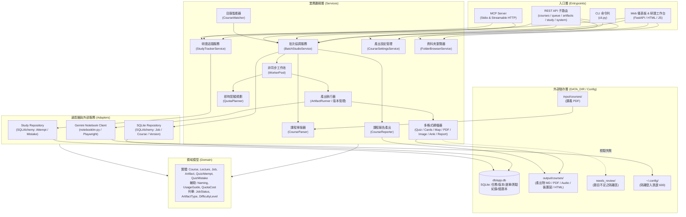

# 系統架構 (Architecture)

> 手動維護本檔的「系統概覽」；結構樹與圖表由工具自動產生或更新。

| 文件 | 內容 | 產生方式 |
|---|---|---|
| [`PROJECT_TREE.md`](PROJECT_TREE.md) | 完整目錄樹 | `agentctl sync` / 每次 commit |
| `GRAPH_REPORT.md` | 模組依賴圖、分層檢查、函式大小 | 需要時 `agentctl graph`（不進 git） |
| `AGENT_AUDIT_REPORT.md` | 各 Agent 的 commit 與任務 | 需要時 `agentctl audit`（不進 git） |

## 1. 系統概覽 (System Overview)

`notebooklm-batch-studio` 是一個專門為大學與進修課程設計的自動化學習輔助系統。使用者只要將每門課程的講義 PDF 放入對應的資料夾，系統便能自動透過 Gemini Notebook (Gemini Notebook) 建立專屬筆記本、逐份講義單獨勾選生成完整複習包（音訊摘要 Audio Overview、30 題階梯式測驗 Quiz、重點閃卡 Flashcards、心智圖 Mind Map、期末模擬考 Mock Exam），並將產出自動更名、轉檔為 Markdown 與列印用 PDF。

系統嚴格遵循單向五層架構（`entrypoints ➔ adapters ➔ services ➔ domain ➔ config`），所有資料與程式碼嚴格分離（儲存於 `DATA_DIR`），並提供三大操作入口：
1. **CLI 命令列介面**：用於批次排程、目錄監看、狀態檢視與身分登入。
2. **FastAPI 本機 Web 控制台**（`http://127.0.0.1:8768`）：直觀管理課程、檢視產出物、重試佇列。
3. **MCP 伺服器 & OpenAPI 路由**：供 Claude Code、Antigravity、Open WebUI 等 AI 工具以對話方式協同操作。



## 2. 單向分層架構 (Layer Breakdown)

依照 `.agents/project.toml` 定義的依賴規範，上層可依賴下層，下層嚴格禁止引用上層：

```text
entrypoints ➔ adapters ➔ services ➔ domain ➔ config
```

### 2.1 入口層 (`entrypoints`)
負責協調外部使用者與外部代理人的請求輸入，不包含業務規則：
- `cli.py`：命令列工具入口，支援 `login`（檢查登入憑證；加 `--browser` 開瀏覽器由使用者親自登入）、`batch`（批次掃描建立）、`status`（即時進度總覽）、`resume`（中斷重試續跑）、`watch`（守護進程監控）與 `web`（啟動 Web 與 MCP 服務）。
- `api.py` 與 `entrypoints/http/`：FastAPI 應用程式，切分為職責分明的子路由：
  - `courses.py`：課程列表、註冊掃描、講次清單、產出物開關設定與伺服器資料夾瀏覽器 (`/api/browse`)。
  - `queue.py`：工作佇列狀態、暫停/恢復、工作重試、版本化重新生成 (`POST /api/jobs/{id}/regenerate`)。
  - `artifacts.py`：檔案安全下載、隔離區 (`needs_review`) 檢視與直接下載、Markdown / HTML 檢視器。
  - `study.py`：研讀工作台 API，包含測驗繳卷即時評分、錯題本查詢與複習掌握標記、Anki 間隔重複 CSV 匯出。
  - `system.py`：系統健康檢查、即時額度狀態、命名規則與研讀導引指南 (`/api/usage-guide`)。
- `entrypoints/static/`：單頁響應式控制台（`index.html`）與學生研讀工作台（`study.html`），內嵌 3D 閃卡翻轉、分段音訊播放器與即時測驗互動。
- `mcp_server.py`：Model Context Protocol (MCP) 伺服器，對外公開課程註冊、佇列控制、產出查詢、研讀數據與 Gemini Notebook 遠端同步等 Tool 與 Resource，關鍵操作具備 `confirm` 確認機制。

### 2.2 適配器層 (`adapters`)
負責與外部系統、持久化儲存與第三方函式庫互動：
- `adapters/notebooklm/`：
  - `client.py`：核心客戶端，提供筆記本操作、單一來源上傳與來源選取、例外捕捉轉換。
  - `generation.py`：精確傳遞繁體中文語系代碼 (`zh_Hant`)、客製提示詞，並精確取得遠端生成物回傳之 `artifact_id`。
  - `downloads.py`：依照 `artifact_id` 精確下載遠端產出，處理語音 `.m4a` 與心智圖改名。
  - `quota.py`：查詢 Gemini Notebook 即時配額表與估算消耗。
- `adapters/db/`：
  - `repository.py` (`SQLiteJobRepository`)：使用 SQLAlchemy 管理課程、講次、工作佇列、客製產出選項 (`course_artifact_selections`) 與版本記錄 (`job_versions`)。
  - `study_repository.py` (`StudyRepository`)：管理學生測驗作答紀錄 (`quiz_attempts`) 與個人錯題本 (`quiz_mistakes`)。
- 檔案系統操作：資料夾監看與 PDF 寫入完成度偵測在 `services/watcher.py`，課程目錄掃描在 `services/course_parser.py`，下載路由的路徑檢核在 `entrypoints/http/artifacts.py`。

### 2.3 業務服務層 (`services`)
系統核心邏輯與工作流排程：
- `orchestrator.py` (`BatchStudioService`)：主管課程註冊、來源同步、任務生成、工作排程與產出持久化。
- `artifact_runner.py`：細緻化產出管線，負責針對各講次各類型產出物調用 Adapter、等待生成完成、依 `artifact_id` 下載改名並處理版本演進（`v2`, `v3`）。
- `study_service.py` (`StudyTrackerService`)：管理學生線上測驗作答驗證、錯題自動入庫、掌握度更新，以及生成 Anki 匯入用牌組。
- `course_settings.py` (`CourseSettingsService`)：管理每門課程的產出類型開關與風格設定，持久化至資料庫與 `course.toml`。
- `folder_browser.py` (`FolderBrowserService`)：提供本機安全目錄層級導航與 PDF 講義資料夾選取。
- `course_parser.py`：依檔名結構排序並剖析課程目錄下的講義 PDF 與中繼資料。
- `worker_pool.py`：控管平行任務排程、依組合展開講次任務，並處理速率限制指數退避重試。
- `quota_planner.py`：讀取 Gemini Notebook 即時配額，於工作執行前進行嚴格預檢（額度不足自動轉入 `QUOTA_WAIT` 狀態，避免浪費重試次數），並支援 5 小時額度窗與每週額度評估。
- `converters/`：
  - `quiz_converter.py`：整併 3 次 10 題測驗，去重並驗證題目數（達 30 題通過，不足則隔離至 `needs_review/`）。
  - `flashcard_converter.py`：將階梯式閃卡轉換為標準 Markdown 與 CSV 格式。
  - `mindmap_converter.py`：轉換階層結構為標準 Markdown 縮排清單與 Mermaid 語法。
  - `pdf_renderer.py`：使用 ReportLab 將 Markdown 測驗卷與答案卷轉換為高畫質列印用 PDF。
  - `image_fitter.py`：為資訊圖表進行裝置解析度最佳化，自動產出直式、A4 PDF、iPad Air 4 (2360x1640) 與 MacBook Pro 14 吋 (3024x1964) 版本。
  - `report_converter.py`：將各類報告（含概念解說）轉為排版完整的離線 HTML 文件。
  - `anki_exporter.py`：匯出 Anki 專用 CSV 牌組格式，包含標籤與自訂欄位。
- `reporter.py`：為每門課程產生整體的 `summary.md` 與可離線瀏覽的 `summary.html`。
- `watcher.py`：監看檔案系統變更，當偵測到新上傳講義且寫入完成後自動加入排程。

### 2.4 領域模型層 (`domain`)
純 Python 商業物件，無任何外部第三方相依：
- 實體與值物件：`Course`, `Lecture`, `Job`, `Artifact`, `Quiz`, `Question`, `Flashcard`, `MindMapNode`, `QuizAttempt`, `QuizMistake`, `JobVersion`。
- 輔助邏輯：`naming.py`（集中控管 Gemini Notebook 遠端標題與本機檔案命名法、版本號尾綴）、`usage_guide.py`（提供課程學習順序、複習規劃與配額解說）。
- 業務列舉：`JobStatus`, `JobType`, `ArtifactType`, `DifficultyLevel`, `CourseProfile`。
- 領域例外：`DomainError`, `NotebookLMError`, `QuotaExceededError`, `AuthExpiredError`。

### 2.5 設定與基礎設施層 (`config`)
- `config.py`：單一來源讀取環境變數，解析 `DATA_DIR`、`HTTP_PORT`、`NOTEBOOKLM_HOME` 等全域設定。
- `logging_setup.py`：設定結構化日誌格式、色彩支援、自動注入 Run ID，並將記錄輸出至 `DATA_DIR/logs/`。

## 3. 核心業務流程與資料流 (Core Workflows)

### 3.1 講義匯入與單一來源生成
1. 使用者將講義放入 `DATA_DIR/input/courses/<CourseCode>/`，或透過 Web UI 目錄瀏覽器挑選加入。
2. 系統解析講義檔名序號（例如 `01_細胞膜.pdf`, `02_酵素.pdf`）。
3. 建立或重用 Gemini Notebook 遠端同名筆記本，並上傳所有來源（重註冊時自動保留既有 `source_id`，避免重複上傳）。
4. **單一來源聚焦**：生成第 N 講的音訊與測驗時，只勾選第 N 份來源 ID（`source_ids=[source_id]`），確保產出專注於當次主題，不互相污染。

### 3.2 30 題階梯式測驗與品質隔離機制
1. 為每講依序發起 3 次 10 題生成任務（基礎題、理解題、模擬考題）。
2. `quiz_converter.py` 整合 3 次產出，去除重複題幹並補齊解析與提示。
3. **品質防護**：若因 Gemini Notebook 擷取異常導致有效題數不足 30 題（或整門課模擬考題數不足），系統自動將原始內容隔離至 `DATA_DIR/needs_review/`，將工作狀態標記為 `NEEDS_REVIEW`，並在總結報告中標記警告。隔離檔案可透過 Web 介面直接檢視或下載。

### 3.3 限額與例外退避 (Quota & Rate-Limit Handling)
1. 每次發起生成前，`quota_planner.py` 讀取即時配額表，若預估配額不足，任務自動標記為 `QUOTA_WAIT` 並排定等待時間，不盲目發送 API。
2. 若在生成過程中 Gemini Notebook 回傳 HTTP 429、USER_DISPLAYABLE_ERROR 或限額耗盡提示，配接層映射為 `QuotaExceededError`。
3. 工作池自動暫停佇列並計算下次重置時間，啟動服務後時間一到即無縫續跑，或透過 CLI `notebooklm-batch-studio resume` 手動續行。

### 3.4 學生研讀工作台與間隔重複 (Study Portal & Spaced Repetition)
1. 學生在研讀工作台（`study.html`）挑選講次測驗進行自主測驗，系統前端提供即時作答與計分反饋。
2. 測驗結果與錯題透過 `study.py` 記錄至 `quiz_attempts` 與 `quiz_mistakes` 資料表。
3. 錯題本持續追蹤各題之掌握狀態（待複習 / 已掌握），學生可一鍵匯出為 Anki 專用 CSV 牌組，進行後續艾賓浩斯間隔重複複習。

### 3.5 版本化重新生成與產出多裝置適配 (Versioned Regeneration & Multi-Device Fit)
1. 當使用者對特定講次的產出不滿意時，可在 Web UI 點擊「🔁 重新生成」，系統自動分配新版號（`v2`, `v3`…）。
2. 既有歷史檔案完整保留，Gemini Notebook 筆記本遠端標題增加 `(v2)` 標籤，本機下載檔名增加 `_v2` 後綴。
3. 資訊圖表產出物透過 `image_fitter.py` 自動轉製並適配為多種裝置規格（直式原圖、A4 PDF、iPad Air 4、MacBook Pro 14 吋），方便學生在不同螢幕閱讀。

## 4. 安全性與環境隔離 (Security & Isolation)

1. **憑證安全**：不讀取亦不儲存使用者 Google 密碼。使用者透過 `login` 指令開啟本機 Chromium 瀏覽器完成 OAuth 登入，登入狀態隔離儲存於 `~/.config/notebooklm-batch-studio`（權限 600）。
2. **服務綁定**：FastAPI 與 MCP 本機伺服器嚴格僅綁定 `127.0.0.1:8768`，並具備 Host Header 檢查機制，禁止對外網暴露。
3. **路徑穿越防護**：所有靜態資源與產出物讀取均通過 `safe_join_path` 嚴格限制於 `DATA_DIR` 內，防止目錄穿越攻擊。
4. **資料隔離**：原始講義、中繼資料、產出物與紀錄檔案全數集中於專案目錄外的 `DATA_DIR`，避免程式碼倉庫污染或敏感講義外流。
