# 系統架構 (Architecture)

> 手動維護本檔的「系統概覽」；結構樹與圖表由工具自動產生或更新。

| 文件 | 內容 | 產生方式 |
|---|---|---|
| [`PROJECT_TREE.md`](PROJECT_TREE.md) | 完整目錄樹 | `agentctl sync` / 每次 commit |
| `GRAPH_REPORT.md` | 模組依賴圖、分層檢查、函式大小 | 需要時 `agentctl graph`（不進 git） |
| `AGENT_AUDIT_REPORT.md` | 各 Agent 的 commit 與任務 | 需要時 `agentctl audit`（不進 git） |

## 1. 系統概覽 (System Overview)

`notebooklm-batch-studio` 是一個專門為大學與進修課程設計的自動化學習輔助系統。使用者只要將每門課程的講義 PDF 放入對應的資料夾，系統便能自動透過 Gemini Notebook (NotebookLM) 建立專屬筆記本、逐份講義單獨勾選生成完整複習包（音訊摘要 Audio Overview、30 題階梯式測驗 Quiz、重點閃卡 Flashcards、心智圖 Mind Map、期末模擬考 Mock Exam），並將產出自動更名、轉檔為 Markdown 與列印用 PDF。

系統嚴格遵循單向五層架構（`entrypoints ➔ adapters ➔ services ➔ domain ➔ config`），所有資料與程式碼嚴格分離（儲存於 `DATA_DIR`），並提供三大操作入口：
1. **CLI 命令列介面**：用於批次排程、目錄監看、狀態檢視與身分登入。
2. **FastAPI 本機 Web 控制台**（`http://127.0.0.1:8768`）：直觀管理課程、檢視產出物、重試佇列。
3. **MCP 伺服器 & OpenAPI 路由**：供 Claude Code、Antigravity、Open WebUI 等 AI 工具以對話方式協同操作。

```mermaid
flowchart TD
    subgraph Storage ["外部儲存層 (DATA_DIR / Config)"]
        PDFs["input/courses/<br/>(講義 PDF)"]
        DB[(db/app.db<br/>SQLite 任務資料庫)]
        Out["output/courses/<br/>(產出物 MD / PDF / Audio)"]
        Quarantine["needs_review/<br/>(題目不足之隔離區)"]
        Creds["~/.config/<br/>(隔離登入憑證 600)"]
    end

    subgraph Entrypoints ["入口層 (Entrypoints)"]
        CLI["CLI 命令列<br/>(cli.py)"]
        WebUI["Web 儀表板<br/>(FastAPI / Jinja2)"]
        API["REST API<br/>(FastAPI 路由)"]
        MCP["MCP Server<br/>(Stdio & HTTP)"]
    end

    subgraph Services ["業務邏輯層 (Services)"]
        Orchestrator["批次協調服務<br/>(BatchStudioService)"]
        Parser["課程掃描器<br/>(CourseParser)"]
        WorkerPool["非同步工作池<br/>(WorkerPool)"]
        Converters["產出轉換器<br/>(Quiz / Cards / Map / PDF)"]
        Reporter["課程報告產出<br/>(CourseReporter)"]
        Watcher["目錄監看器<br/>(CourseWatcher)"]
    end

    subgraph Adapters ["適配器與外部服務 (Adapters)"]
        NLMAdapter["NotebookLM Client<br/>(notebooklm-py / Playwright)"]
        Repo["SQLite Repository<br/>(SQLAlchemy)"]
        FSAdapter["FileSystem Probe<br/>(檔案穩定偵測)"]
    end

    subgraph Domain ["領域模型 (Domain)"]
        Models["實體: Course, Lecture, Job, Artifact<br/>值物件: Quiz, Question, Flashcard<br/>列舉: JobStatus, ArtifactType"]
    end

    PDFs --> Parser
    CLI & WebUI & API & MCP --> Orchestrator
    Orchestrator --> Parser
    Orchestrator --> WorkerPool
    WorkerPool --> NLMAdapter
    NLMAdapter --> Creds
    NLMAdapter --> Converters
    Converters --> Out
    Converters -. 檢驗失敗 .-> Quarantine
    Orchestrator --> Repo
    Repo --> DB
    Orchestrator --> Reporter
    Reporter --> Out
    Watcher --> Orchestrator
    Services --> Domain
    Adapters --> Domain
```



## 2. 單向分層架構 (Layer Breakdown)

依照 `.agents/project.toml` 定義的依賴規範，上層可依賴下層，下層嚴格禁止引用上層：

```text
entrypoints ➔ adapters ➔ services ➔ domain ➔ config
```

### 2.1 入口層 (`entrypoints`)
負責協調外部使用者與外部代理人的請求輸入，不包含業務規則：
- `cli.py`：命令列工具入口，支援 `login`（檢查登入憑證；加 `--browser` 開瀏覽器由使用者親自登入）、`batch`（批次掃描建立）、`status`（即時進度總覽）、`resume`（中斷重試續跑）、`watch`（守護進程監控）與 `web`（啟動 Web 與 MCP 服務）。
- `api.py` 與 `entrypoints/http/`：FastAPI 應用程式，掛載子路由（`courses.py`, `queue.py`, `artifacts.py`, `study.py`, `system.py`），提供靜態儀表板模板與 OpenAPI 規範接口（供 Open WebUI 整合）。
- `mcp_server.py`：Model Context Protocol (MCP) 伺服器，對外公開課程註冊、佇列執行、產出查詢等 Tool 與 Resource，包含對破壞性操作之 `confirm` 確認機制。

### 2.2 適配器層 (`adapters`)
負責與外部系統、持久化儲存與第三方函式庫互動：
- `adapters/notebooklm/client.py`：封裝 `notebooklm-py` 與 Playwright 補位機制，實現講義上傳、單一來源勾選、音訊/測驗/閃卡/心智圖生成與更名，並將非受控例外轉換為純領域例外（`QuotaExceededError`, `AuthExpiredError` 等）。
- `adapters/db/`：使用 SQLAlchemy 與 SQLite 實作 `SQLiteJobRepository`，透過 `session_scope()` 保證交易一致性。
- 檔案系統操作沒有獨立的 adapter：資料夾監看與 PDF 寫入完成度偵測（防止讀取複製中的不完整 PDF）在 `services/watcher.py`，課程掃描在 `services/course_parser.py`，下載路由的路徑檢核在 `entrypoints/http/artifacts.py`。

### 2.3 業務服務層 (`services`)
系統核心邏輯與工作流排程：
- `orchestrator.py` (`BatchStudioService`)：主管課程註冊、來源同步、任務生成、工作排程與產出持久化。
- `course_parser.py`：依檔名結構排序並剖析課程目錄下的講義 PDF 與中繼資料。
- `worker_pool.py`：控管平行任務排程、依設定檔組合（`full`, `quiz-only`, `exam-prep`）展開講次任務，並處理速率限制指數退避重試。
- `converters/`：
  - `quiz_converter.py`：整併 3 次 10 題測驗，去重並驗證題目數（達 30 題通過，不足則隔離）。
  - `flashcard_converter.py`：將階梯式閃卡轉換為標準 Markdown、CSV (Anki) 格式。
  - `mindmap_converter.py`：轉換階層結構為標準 Markdown 縮排清單與 Mermaid 語法。
  - `pdf_renderer.py`：使用 ReportLab 將 Markdown 測驗卷與閃卡轉換為高畫質列印用 PDF。
- `reporter.py`：為每門課程產生整體的 `summary.md` 與可離線瀏覽的 `summary.html`。
- `watcher.py`：監看檔案系統變更，當偵測到新上傳講義且寫入完成後自動加入排程。
- `quota_planner.py`：讀 NotebookLM 即時額度表，工作開始前檢查該動作是否還有額度（不足就進 QUOTA_WAIT，不送出請求），並用每種動作的實際花費估算新課程需要幾個 5 小時額度窗。

### 2.4 領域模型層 (`domain`)
純 Python 商業物件，無任何外部第三方相依：
- 實體與值物件：`Course`, `Lecture`, `Job`, `Artifact`, `Quiz`, `Question`, `Flashcard`, `MindMapNode`。
- 業務列舉：`JobStatus`, `JobType`, `ArtifactType`, `DifficultyLevel`, `CourseProfile`。
- 領域例外：`DomainError`, `NotebookLMError`, `QuotaExceededError`, `AuthExpiredError`。

### 2.5 設定與基礎設施層 (`config`)
- `config.py`：單一來源讀取環境變數，解析 `DATA_DIR`、`HTTP_PORT`、`NOTEBOOKLM_HOME` 等全域設定。
- `logging_setup.py`：設定結構化日誌格式、色彩支援、自動注入 Run ID，並將記錄輸出至 `DATA_DIR/logs/`。

## 3. 核心業務流程與資料流 (Core Workflows)

### 3.1 講義匯入與單一來源生成
1. 使用者將講義放入 `DATA_DIR/input/courses/<CourseCode>/`。
2. 系統解析講義檔名序號（例如 `01_細胞膜.pdf`, `02_酵素.pdf`）。
3. 建立或重用 NotebookLM 遠端同名筆記本，並上傳所有來源。
4. **單一來源聚焦**：生成第 N 講的音訊與測驗時，只勾選第 N 份來源 ID（`source_ids=[source_id]`），確保產出專注於當次主題，不互相污染。

### 3.2 30 題階梯式測驗與品質隔離機制
1. 為每講依序發起 3 次 10 題生成任務（基礎題、理解題、模擬考題）。
2. `quiz_converter.py` 整合 3 次產出，去除重複題幹並補齊解析與提示。
3. **品質防護**：若因 NotebookLM 擷取異常導致有效題數不足 30 題，系統自動將原始內容隔離至 `DATA_DIR/needs_review/`，並在總結報告中標記警告，由使用者手動審查或重新排程。

### 3.3 限額與例外退避 (Quota & Rate-Limit Handling)
1. 當 NotebookLM 回傳 HTTP 429 或限額耗盡提示時，配接層映射為 `QuotaExceededError`。
2. 工作池暫停當前講次後續生成，將任務狀態標記為 `failed` 並記錄下次重試時間點，避免因頻繁呼叫導致帳號受限。
3. 使用者可透過 `notebooklm-batch-studio resume` 隨時自中斷點無縫接關。

## 4. 安全性與環境隔離 (Security & Isolation)

1. **憑證安全**：不讀取亦不儲存使用者 Google 密碼。使用者透過 `login` 指令開啟本機 Chromium 瀏覽器完成 OAuth 登入，登入狀態隔離儲存於 `~/.config/notebooklm-batch-studio`（權限 600）。
2. **服務綁定**：FastAPI 與 MCP 本機伺服器嚴格僅綁定 `127.0.0.1:8768`，並具備 Host Header 檢查機制，禁止對外網暴露。
3. **路徑穿越防護**：所有靜態資源與產出物讀取均通過 `safe_join_path` 嚴格限制於 `DATA_DIR` 內，防止目錄穿越攻擊。
4. **資料隔離**：原始講義、中繼資料、產出物與紀錄檔案全數集中於專案目錄外的 `DATA_DIR`，避免程式碼倉庫污染或敏感講義外流。
