# 系統架構 (Architecture)

> 手動維護本檔的「系統概覽」；結構樹與圖表由工具自動產生或更新。

| 文件 | 內容 | 產生方式 |
|---|---|---|
| [`PROJECT_TREE.md`](PROJECT_TREE.md) | 完整目錄樹 | `agentctl sync` / 每次 commit |
| `GRAPH_REPORT.md` | 模組依賴圖、分層檢查、函式大小 | 需要時 `agentctl graph`（不進 git） |
| `AGENT_AUDIT_REPORT.md` | 各 Agent 的 commit 與任務 | 需要時 `agentctl audit`（不進 git） |

## 1. 系統概覽 (System Overview)

`notebooklm-batch-studio` 是一個專門為大學與進修課程設計的自動化學習輔助系統。使用者只要將每門課程的講義 PDF 放入對應的資料夾，系統便能自動透過 Gemini Notebook (Gemini Notebook) 建立專屬筆記本、逐份講義單獨勾選生成完整複習包（音訊摘要 Audio Overview、30 題階梯式測驗 Quiz、重點閃卡 Flashcards、心智圖 Mind Map、期末模擬考 Mock Exam），並將產出自動更名、轉檔為 Markdown 與列印用 PDF。

此外，系統整合了完整的**學生學習體驗與認知心理學輔助**（SPEC-007、SPEC-008）：
- **課件智慧閱讀器**：直接在瀏覽器以內建 PDF.js 檢閱講義，色彩對應 Gemini Notebook 萃取的關鍵重點與原文引據位置。
- **遺忘曲線記憶強度**：依艾賓浩斯遺忘曲線數學模型即時評估各講掌握度（半衰期衰減），並以熱圖與連續天數視覺化呈現。
- **蘇格拉底式引導家教 (Socratic Tutor)**：連貫對話情境，引導思考而非直接餵答案。
- **作答前信心評分**：比對「確定卻答錯」的認知盲點，提供深度警示與 AI 詳解。
- **今日計畫與間隔複習**：動態排程「Today」研讀進度、考前倒數計時與 25 分鐘專注番茄鐘。

系統嚴格遵循單向五層架構（`entrypoints ➔ adapters ➔ services ➔ domain ➔ config`），所有資料與程式碼嚴格分離（儲存於 `DATA_DIR`），並提供三大操作入口：
1. **CLI 命令列介面**：用於批次排程、目錄監看、狀態檢視與身分登入。
2. **FastAPI 本機 Web 控制台**（`http://127.0.0.1:8768`）：包含管理控制台、研讀工作台、智慧閱讀器與 macOS 一鍵專注視窗。
3. **MCP 伺服器 & OpenAPI 路由**：供 Claude Code、Antigravity、Open WebUI 等 AI 工具以對話方式協同操作。

```mermaid
flowchart TD
    subgraph Storage ["外部儲存層 (DATA_DIR / Config)"]
        PDFs["input/courses/<br/>(講義 PDF)"]
        DB[(db/app.db<br/>SQLite: 任務/版本/選單/測驗/錯題/進度/間隔複習/重點/家教)]
        Out["output/courses/<br/>(產出物 MD / PDF / Audio / 裝置圖 / HTML)"]
        Quarantine["needs_review/<br/>(題目不足之隔離區)"]
        Creds["~/.config/<br/>(隔離登入憑證 600)"]
    end

    subgraph Entrypoints ["入口層 (Entrypoints)"]
        CLI["CLI 命令列<br/>(cli.py)"]
        WebUI["Web 儀表板 & 研讀工作台 & 閱讀器<br/>(FastAPI / HTML / JS / PDF.js)"]
        API["REST API 子路由<br/>(courses / queue / artifacts / study / learning / plan / settings / system)"]
        MCP["MCP Server 集群<br/>(Core / Course Settings / Job Prompts / Learning / Study Plan)"]
    end

    subgraph Services ["業務邏輯層 (Services)"]
        Orchestrator["批次協調服務<br/>(BatchStudioService)"]
        ArtifactRunner["產出執行器<br/>(ArtifactRunner / 版本管理)"]
        StudyService["研讀追蹤服務<br/>(StudyTrackerService)"]
        LearningService["學習輔助服務<br/>(LearningService / 閱讀器重點 / 家教)"]
        StudyPlanService["研讀計畫服務<br/>(StudyPlanService / 今日計畫 / 間隔複習)"]
        QuizReader["測驗讀取器<br/>(QuizReader)"]
        CourseSettings["產出設定管理<br/>(CourseSettingsService)"]
        FolderBrowser["資料夾瀏覽器<br/>(FolderBrowserService)"]
        QuotaPlanner["即時配額規劃<br/>(QuotaPlanner)"]
        Parser["課程掃描器<br/>(CourseParser)"]
        WorkerPool["非同步工作池<br/>(WorkerPool)"]
        Converters["多格式轉檔器<br/>(Quiz / Cards / Map / PDF / Image / Anki / Report)"]
        Reporter["課程報告產出<br/>(CourseReporter)"]
        Watcher["目錄監看器<br/>(CourseWatcher)"]
    end

    subgraph Adapters ["適配器與外部服務 (Adapters)"]
        NLMAdapter["Gemini Notebook Client<br/>(notebooklm-py / Playwright)"]
        Repo["SQLite Repository<br/>(Job / Course / Version / Selection)"]
        StudyRepo["Study Repository<br/>(Attempt / Mistake)"]
        LearningRepo["Learning Repository<br/>(KeyPoint / TutorMessage)"]
        ReviewRepo["Review Repository<br/>(StudyProgress / ReviewItem / Explanation)"]
    end

    subgraph Domain ["領域模型 (Domain)"]
        Models["實體: Course, Lecture, Job, Artifact, QuizAttempt, QuizMistake<br/>實體: StudyProgress, ReviewItem, KeyPoint, TutorMessage<br/>模型: MemoryModel, StudyPlan, NotebookLMProtocol<br/>輔助: Naming, UsageGuide, QuotaCost"]
    end

    PDFs --> Parser
    CLI & WebUI & API & MCP --> Orchestrator
    WebUI & API & MCP --> StudyService
    WebUI & API & MCP --> LearningService
    WebUI & API & MCP --> StudyPlanService
    WebUI & API --> CourseSettings
    WebUI & API --> FolderBrowser
    Orchestrator --> Parser
    Orchestrator --> WorkerPool
    WorkerPool --> ArtifactRunner
    WorkerPool --> QuotaPlanner
    ArtifactRunner --> NLMAdapter
    LearningService --> NLMAdapter
    StudyPlanService --> NLMAdapter
    NLMAdapter --> Creds
    ArtifactRunner --> Converters
    Converters --> Out
    Converters -. 檢驗失敗 .-> Quarantine
    Orchestrator --> Repo
    StudyService --> StudyRepo
    LearningService --> LearningRepo
    StudyPlanService --> ReviewRepo
    Repo & StudyRepo & LearningRepo & ReviewRepo --> DB
    Orchestrator --> Reporter
    Reporter --> Out
    Watcher --> Orchestrator
    Services --> Domain
    Adapters --> Domain
```



## 2. 單向分層架構 (Layer Breakdown)

依照 `.agents/project.toml` 定義的依賴規範，上層可依賴下層，下層嚴格禁止引用上層：

```text
entrypoints ➔ adapters ➔ services ➔ domain ➔ config
```

### 2.1 入口層 (`entrypoints`)
負責協調外部使用者與外部代理人的請求輸入，不包含業務規則：
- `cli.py`：命令列工具入口，支援 `login`（檢查登入憑證；加 `--browser` 開瀏覽器由使用者親自登入）、`batch`（批次掃描建立）、`status`（即時進度總覽）、`resume`（中斷重試續跑）、`watch`（守護進程監控）與 `web`（啟動 Web 與 MCP 服務）。
- `api.py` 與 `entrypoints/http/`：FastAPI 應用程式，切分為職責分明的子路由：
  - `courses.py`：課程列表、註冊掃描、講次清單。
  - `queue.py`：工作佇列狀態、暫停/恢復（恢復時一併喚醒等待額度的工作）、工作重試、Prompt 檢視與編輯 (`GET/POST /api/jobs/{id}/prompt`)。
  - `artifacts.py`：檔案安全下載、隔離區 (`needs_review`) 檢視與直接下載、Markdown / HTML 檢視器。
  - `study.py`：研讀工作台 API，包含測驗繳卷即時評分、錯題本查詢與複習掌握標記、Anki 間隔重複 CSV 匯出。
  - `learning.py`：講義 PDF 安全串流閱讀、重點標註檢視、蘇格拉底式引導家教對話。
  - `plan.py`：學生個人學習計畫（Today）、複習排程、作答 AI 詳解保存與考前倒數。
  - `settings.py`：產出細部選項設定（題型、題量、語言、方向、風格）、三層設定繼承與重設、版本化重新生成 (`POST /api/courses/{code}/jobs/regenerate`)、產出物開關、課程暫停／開始／刪除、點選式資料夾瀏覽 (`/api/folders`)。
  - `system.py`：系統健康檢查、即時額度狀態、命名規則與研讀導引指南 (`/api/usage-guide`)。
  - `preferences.py`：網頁偏好讀寫與重設（`/api/preferences`，存在 SQLite `ui_preferences`，ADR-009）。
  - `fonts.py`：下載 Google Fonts 到 `DATA_DIR/fonts/` 並離線提供（`/api/fonts`，ADR-009）。
- `entrypoints/static/`：前端使用者介面（純原生 JS，無編譯負擔）：
  - `index.html`：v05 介面（SPEC-009、ADR-008）：側欄四頁（研讀總覽、研讀工作室、弱點複習、批次排程）、側欄底部工具（使用方法、專注模式、設計與自訂）與對話框。
  - `studio-theme.css`（配色 tokens）、`studio.css`（版面與元件）、`studio-learning.css`（閱讀器、記憶卡、家教）。
  - 功能層：`studio-core.js`（對話框、斷線提示、選項洗牌）、`studio-app.js`（研讀課程與講次、測驗、錯題、學習卡、報告檢視）、`studio-batch.js`（批次排程與工作清單）、`studio-settings.js`（課程設定、產出內容、Prompt、加入課程精靈）、`studio.js`（研讀總覽、交卷回饋、解釋、間隔複習、音檔續播）、`studio-learning.js`（記憶強度、信心評分、混合複習、番茄鐘、家教）、`studio-reader.js`（講義 PDF 閱讀器與重點畫線）。
  - 外殼層：`studio-shell.js`（偏好、側欄、頁面切換）、`studio-player.js`（播放真實語音摘要的唱盤與四種視覺）、`studio-bench.js`（工作台、三種版面、本講重點、今日學習卡）、`studio-start.js`（設計與自訂、欄寬、鍵盤與觸控、啟動）。
  - `studio-fonts.js`：設計與自訂的字型選擇與 Google Fonts 下載。
  - `studio-focus.js`：番茄鐘（專注、短休息、長休息），計時收進側欄，習慣存在偏好。
  - 側欄是 `position: fixed` 貼齊視窗上下緣（ISSUE-031）；換頁是腳本控制的淡出 / 浮上（ISSUE-032）。
  - `vendor/pdfjs/`：內建 PDF.js 4.10.38 閱讀核心，完全離線運作。
  - `vendor/lucide/`、`vendor/fonts/`：內建圖示字型與 Noto Sans / Serif TC，離線也能顯示（ADR-009）。
- 線上示範頁：`scripts/build_demo.py` 把上述靜態檔內嵌成單一的 `docs/demo/index.html`，搭配 `scripts/demo/` 的虛構課程與在瀏覽器裡回應 API 的模擬層（GitHub Pages 用，不連後端）。
- `mcp_server.py` 與 MCP 集群：
  - `mcp_server.py`：核心 MCP 工具（狀態、佇列控制、筆記本操作）。
  - `mcp_course_settings.py`：課程選項與產出設定工具。
  - `mcp_job_prompts.py`：提示詞查詢與改寫工具。
  - `mcp_learning.py`：重點查詢、閱讀狀態與家教對話工具。
  - `mcp_study_plan.py`：研讀計畫與間隔複習工具。
- `port_check.py`：啟動前檢查埠號；被佔用時列出佔用程式並停止（與 uvicorn 一樣使用 `SO_REUSEADDR`，ISSUE-027）。全機埠號總表在 `00 init_dev_env/PORTS.md`。
- `/static` 以 `NoCacheStaticFiles` 掛載（`Cache-Control: no-cache`），更新後瀏覽器不會沿用舊的 CSS／JS（ISSUE-028）。
- 一鍵桌面啟動：
  - `scripts/build_mac_app.sh`：編譯 macOS 一鍵啟動 App。
  - `scripts/launch_app.sh`：自動啟動本機伺服器並以 Chrome `--app` 全螢幕專注視窗呈現。

### 2.2 適配器層 (`adapters`)
負責與外部系統、持久化儲存與第三方函式庫互動：
- `adapters/notebooklm/`：
  - `client.py`：核心客戶端，提供筆記本操作、單一來源上傳與來源選取、例外捕捉轉換。
  - `generation.py`：精確傳遞繁體中文語系代碼 (`zh_Hant`)、客製提示詞，並精確取得遠端生成物回傳之 `artifact_id`。
  - `downloads.py`：依照 `artifact_id` 精確下載遠端產出，處理語音 `.m4a` 與心智圖改名。
  - `quota.py`：查詢 Gemini Notebook 即時配額表與估算消耗。
- `adapters/db/`：
  - `repository.py` (`SQLiteJobRepository`)：使用 SQLAlchemy 管理課程、講次、工作佇列、客製產出選項 (`course_artifact_selections`) 與版本記錄 (`job_versions`)。
  - `study_repository.py` (`StudyRepository`)：管理學生測驗作答紀錄 (`quiz_attempts`) 與個人錯題本 (`quiz_mistakes`)。
  - `learning_repository.py` (`LearningRepository`)：管理講義 PDF 重點標註萃取 (`key_points`) 與蘇格拉底家教對話紀錄 (`tutor_messages`)。
  - `review_repository.py` (`ReviewRepository`)：管理研讀步驟進度 (`study_progress`)、艾賓浩斯間隔複習卡片 (`review_items`) 與 AI 題目詳解 (`explanations`)。
- 檔案系統操作：資料夾監看與 PDF 寫入完成度偵測在 `services/watcher.py`，課程目錄掃描在 `services/course_parser.py`，下載路由與 PDF 閱讀器的路徑檢核在 `entrypoints/http/artifacts.py` 與 `learning.py`。

### 2.3 業務服務層 (`services`)
系統核心邏輯與工作流排程：
- `orchestrator.py` (`BatchStudioService`)：主管課程註冊、來源同步、任務生成、工作排程與產出持久化。
- `artifact_runner.py`：細緻化產出管線，負責針對各講次各類型產出物調用 Adapter、等待生成完成、依 `artifact_id` 下載改名並處理版本演進（`v2`, `v3`）。
- `learning_service.py` (`LearningService`)：提供講義 PDF 安全讀取串流、一次性萃取並儲存 Gemini Notebook 講義核心重點、管理蘇格拉底式引導家教的對話推進。
- `study_plan_service.py` (`StudyPlanService`)：計算學生每日「Today」研讀進度、維護艾賓浩斯間隔複習排程、呼叫 Gemini Notebook 取得答案詳解並永久保存。
- `study_service.py` (`StudyTrackerService`)：管理學生線上測驗作答驗證、錯題自動入庫、掌握度更新，以及生成 Anki 匯入用牌組。
- `quiz_reader.py`：解析各講次測驗 Markdown 檔案，結構化為作答題目與選項陣列。
- `course_settings.py` (`CourseSettingsService`)：管理每門課程的產出類型開關與風格設定，持久化至資料庫與 `course.toml`。
- `folder_browser.py` (`FolderBrowserService`)：提供本機安全目錄層級導航與 PDF 講義資料夾選取。
- `course_parser.py`：依檔名結構排序並剖析課程目錄下的講義 PDF 與中繼資料。
- `worker_pool.py`：控管平行任務排程、依組合展開講次任務，並處理速率限制指數退避重試。
- `quota_planner.py`：讀取 Gemini Notebook 即時配額，於工作執行前進行嚴格預檢（額度不足自動轉入 `QUOTA_WAIT` 狀態，避免浪費重試次數），並支援 5 小時額度窗與每週額度評估。
- `converters/`：
  - `quiz_converter.py`：整併 3 次 10 題測驗，去重並驗證題目數（達 30 題通過，不足則隔離至 `needs_review/`），並打散正確選項位置避免偏誤。
  - `flashcard_converter.py`：將階梯式閃卡轉換為標準 Markdown 與 CSV 格式。
  - `mindmap_converter.py`：轉換階層結構為標準 Markdown 縮排清單與 Mermaid 語法。
  - `pdf_renderer.py`：使用 ReportLab 將 Markdown 測驗卷與答案卷轉換為高畫質列印用 PDF。
  - `image_fitter.py`：為資訊圖表進行裝置解析度最佳化，自動產出直式、A4 PDF、iPad Air 4 (2360x1640) 與 MacBook Pro 14 吋 (3024x1964) 版本。
  - `report_converter.py`：將各類報告（含概念解說）轉為排版完整的離線 HTML 文件。
  - `anki_exporter.py`：匯出 Anki 專用 CSV 牌組格式，包含標籤與自訂欄位。
- `reporter.py`：為每門課程產生整體的 `summary.md` 與可離線瀏覽的 `summary.html`。
- `watcher.py`：監看檔案系統變更，當偵測到新上傳講義且寫入完成後自動加入排程。

### 2.4 領域模型層 (`domain`)
純 Python 商業物件，無任何外部第三方相依：
- 實體與值物件：`Course`, `Lecture`, `Job`, `Artifact`, `Quiz`, `Question`, `Flashcard`, `MindMapNode`, `QuizAttempt`, `QuizMistake`, `JobVersion`。
- 學習與研讀模型：`memory_model.py`（艾賓浩斯記憶強度、半衰期衰減與掌握度等級計算）、`study_plan.py`（今日任務清單、考前倒數天數、間隔複習卡片）、`notebooklm_protocol.py`（定義 Gemini Notebook 通訊協定與資料介面）。
- 輔助邏輯：`naming.py`（集中控管 Gemini Notebook 遠端標題與本機檔案命名法、版本號尾綴）、`usage_guide.py`（提供課程學習順序、複習規劃與配額解說）。
- 業務列舉：`JobStatus`, `JobType`, `ArtifactType`, `DifficultyLevel`, `CourseProfile`。
- 領域例外：`DomainError`, `NotebookLMError`, `QuotaExceededError`, `AuthExpiredError`。

### 2.5 設定與基礎設施層 (`config`)
- `config.py`：單一來源讀取環境變數，解析 `DATA_DIR`、`HTTP_PORT`、`NOTEBOOKLM_HOME` 等全域設定。
- `logging_setup.py`：設定結構化日誌格式、色彩支援、自動注入 Run ID，並將記錄輸出至 `DATA_DIR/logs/`。

---

## 3. 核心業務流程與資料流 (Core Workflows)

### 3.1 講義匯入與單一來源生成
1. 使用者將講義放入 `DATA_DIR/input/courses/<CourseCode>/`，或透過 Web UI 目錄瀏覽器挑選加入。
2. 系統解析講義檔名序號（例如 `01_細胞膜.pdf`, `02_酵素.pdf`）。
3. 建立或重用 Gemini Notebook 遠端同名筆記本，並上傳所有來源（重註冊時自動保留既有 `source_id`，避免重複上傳）。
4. **單一來源聚焦**：生成第 N 講的音訊與測驗時，只勾選第 N 份來源 ID（`source_ids=[source_id]`），確保產出專注於當次主題，不互相污染。

### 3.2 30 題階梯式測驗與品質隔離機制
1. 為每講依序發起 3 次 10 題生成任務（基礎題、理解題、模擬考題）。
2. `quiz_converter.py` 整合 3 次產出，去除重複題幹並補齊解析與提示，且打散答案位置消除選項偏誤（ISSUE-021）。
3. **品質防護**：若因 Gemini Notebook 擷取異常導致有效題數不足 30 題（或整門課模擬考題數不足），系統自動將原始內容隔離至 `DATA_DIR/needs_review/`，將工作狀態標記為 `NEEDS_REVIEW`，並在總結報告中標記警告。隔離檔案可透過 Web 介面直接檢視或下載。

### 3.3 限額與例外退避 (Quota & Rate-Limit Handling)
1. 每次發起生成前，`quota_planner.py` 讀取即時配額表，若預估配額不足，任務自動標記為 `QUOTA_WAIT` 並排定等待時間，不盲目發送 API。
2. 若在生成過程中 Gemini Notebook 回傳 HTTP 429、USER_DISPLAYABLE_ERROR 或限額耗盡提示，配接層映射為 `QuotaExceededError`。
3. 工作池自動暫停佇列並計算下次重置時間，啟動服務後時間一到即無縫續跑，或透過 CLI `notebooklm-batch-studio resume` 手動續行。

### 3.4 學生研讀工作台與間隔重複 (Study Portal & Spaced Repetition)
1. 學生在研讀工作台挑選講次測驗進行自主測驗，系統前端提供即時作答與計分反饋。
2. 測驗結果與錯題透過 `study.py` 記錄至 `quiz_attempts` 與 `quiz_mistakes` 資料表。
3. 錯題本持續追蹤各題之掌握狀態（待複習 / 已掌握），學生可一鍵匯出為 Anki 專用 CSV 牌組，進行後續艾賓浩斯間隔重複複習。

### 3.5 版本化重新生成與產出多裝置適配 (Versioned Regeneration & Multi-Device Fit)
1. 當使用者對特定講次的產出不滿意時，可在 Web UI 點擊「🔁 重新生成」，系統自動分配新版號（`v2`, `v3`…）。
2. 既有歷史檔案完整保留，Gemini Notebook 筆記本遠端標題增加 `(v2)` 標籤，本機下載檔名增加 `_v2` 後綴。
3. 資訊圖表產出物透過 `image_fitter.py` 自動轉製並適配為多種裝置規格（直式原圖、A4 PDF、iPad Air 4、MacBook Pro 14 吋），方便學生在不同螢幕閱讀。

### 3.6 學習心理學與智慧閱讀 (Learning Aids & PDF Reader, SPEC-008)
1. **講義智慧閱讀**：透過前端整合的 PDF.js 4.10.38 閱讀器，直接檢閱投影片與教材，不需切換視窗。
2. **AI 重點對應**：由 Gemini Notebook 自動萃取 10~15 個核心重點，並於 PDF 文字層自動標註高亮與引言定位。
3. **遺忘曲線記憶強度**：根據學生最後一次研讀或測驗的時間，依半衰期衰減公式即時計算記憶強度百分比（80% 以上掌握、40%~80% 需加強、40% 以下生疏），並在地圖中以色彩即時提示。
4. **認知盲點偵測**：作答前要求學生評估信心（確定 / 不確定 / 猜測）。若評估為「確定」卻答錯（Sure-but-Wrong），系統標註強烈認知盲點警示，加強後續間隔複習頻率。
5. **蘇格拉底式引導家教**：針對講次或題目發起討論，由 AI 進行啟發式提問引導思考，並保持多輪連貫對話歷史。

### 3.7 學生研讀計畫與間隔複習 (Study Plan & Spaced Review, SPEC-007)
1. **Today 每日排程**：根據課程考試日期、目前進度與記憶強度，自動規劃今日建議研讀之講次教材與複習題。
2. **考前倒數與衝刺**：自動比對行事曆考期，動態調整複習密度與模擬考配比。
3. **跨講混合複習**：整合多講次的錯題與閃卡進行交錯練習（Interleaving Practice），提高長期記憶保留率。
4. **AI 詳解保存**：當學生對題目不解時，可向 Gemini Notebook 索取概念詳解，系統將答案 Markdown 儲存至資料庫 (`explanations`)，後續檢閱秒開無需重新查詢。

### 3.8 獨立產出規格微調 (Per-Artifact Settings, SPEC-006)
1. 支援個別調整單一產出物的生成設定（例如特定講次測驗改為 50 題、特定講次資訊圖表指定橫式或復古風格）。
2. **三層設定繼承架構**：系統全域預設 ➔ 課程級設定 (`course.toml` / 資料庫) ➔ 個別講次覆寫，未設定之屬性自動向上繼承。
3. 支援一鍵重設為系統預設值，確保設定調整具備彈性與可逆性。

### 3.9 學生研讀工作室與視覺分級多媒體 (Study Studio & Visual Tiering, SPEC-009, ADR-007, ADR-008)

> **狀態：已實作（2026-11-02，v05，ADR-008）。** 依 `docs/design/version_05_claude_template.html` 套用到 `entrypoints/static/`。與下列 ADR-007 原始描述不同處：導覽改為左側圖示側欄，「設計與自訂」在側欄底部（不是第 4 個主分頁）；播放器四種視覺共用同一套繪圖，並有側欄迷你播放器。其餘（視覺分級、免分頁工作台、RWD、原型歸檔）照舊。

1. **奢華擬態黑膠留聲基座 (Skeuomorphic Turntable)**：
   - 採用 `conic-gradient` 呈現 4 象限十字光澤流轉（非均向性反射 Anisotropic Sheen）與同心微音軌，模擬真實黑膠唱片的深度閱讀隱喻。
   - **機械唱臂物理動態**：播放時優雅下旋 24° 落針至音軌，暫停時平滑回彈 -6° 歸位，提供行為層零負擔之播放狀態感知。
   - **270° 環形進度弧線軌道**：圍繞黑膠外緣搭配發光刻度微珠（Luminous Progress Bead），模擬鐘錶時間空間感知。
   - **多維聲學畫布庫**：支援典雅黑膠、多重諧波正弦波、天體環形頻譜與 22 頻段霓虹 LED 方塊矩陣一鍵切換。
2. **知識產出物全景平鋪九宮格矩陣 (9-Tool Overview Grid)**：
   - 9 大產出物（PDF、語音、指南、心智圖、資訊圖表、簡報、數據表、30題測驗、3D抽認卡）整齊平鋪，點選任何卡片直接在下方展開對應內容，消滅分頁切換疲勞。
3. **頂部獨立主分頁「設計與自訂」**：
   - 與進度看板、研讀工作室、批次排程並列同級，集中管理外觀、頭像、架構與聲學風格。
4. **全設備雙軌響應式選擇器 (Dual-Target RWD)**：
   - 同時綁定 `@media (max-width: 680px), [data-device="iphone"]`，使桌面 iPhone 模擬器與真實行動裝置皆能精準觸發單欄垂直重排、唱盤等比縮放與零溢出。
5. **獨立版本探索歸檔 (`docs/design/`)**：
   - 包含 Version 1（經典排程）、Version 2（心流雙欄）、Version 3（奢華黑膠）、Version 4（九宮格矩陣與全RWD）自包含檔案與 `DESIGN.md`。

---

## 4. 安全性與環境隔離 (Security & Isolation)

1. **憑證安全**：不讀取亦不儲存使用者 Google 密碼。使用者透過 `login` 指令開啟本機 Chromium 瀏覽器完成 OAuth 登入，登入狀態隔離儲存於 `~/.config/notebooklm-batch-studio`（權限 600）。
2. **服務綁定**：FastAPI 與 MCP 本機伺服器嚴格僅綁定 `127.0.0.1:8768`，並具備 Host Header 檢查機制，禁止對外網暴露。
3. **路徑穿越防護**：產出物下載與檢視都限制在該課程的輸出資料夾（或 `needs_review` 隔離區）內；講義 PDF 閱讀器只提供已註冊講次的檔案，並檢查解析後的路徑必須位於該課程的講義資料夾內（否則回 403），且只讀不改。
4. **資料隔離**：原始講義、中繼資料、產出物與紀錄檔案全數集中於專案目錄外的 `DATA_DIR`，避免程式碼倉庫污染或敏感講義外流。
