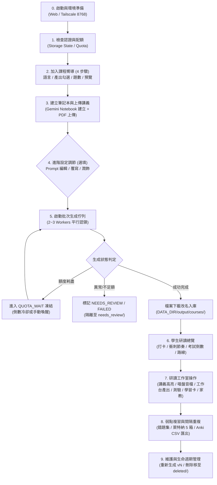

# SPEC-010：端到端使用者完整工作流程規格書 (End-to-End User Workflow & Journey)

- **狀態**：Implemented（統一目錄與封存刪除前保護由 SPEC-014 / ADR-014 接續：改以 `DATA_DIR/study/<學期>/<課程>/<分類>`、封存後才可刪除、不搬刪 `study/` 檔案、`record-only` 與 `adopt-outputs` 為準）
- **日期**：2026-11-10（2026-11-25 附註對齊 SPEC-014）
- **相關任務 / ADR**：TASK-001 ~ TASK-020, TASK-035 / ADR-001 ~ ADR-009, ADR-014 / ISSUE-034 ~ ISSUE-037, ISSUE-065 ~ ISSUE-068

---

## 1. 目標

定義「Gemini Notebook 學習工作室」從**使用者第一次啟動、講義準備、批次加入、設定調節、佇列生成、檔案下載，到研讀工作室、總覽打卡、錯題複習、間隔學習與刪除歸零**的完整且細緻的端到端工作流程（User Workflow）。
確保流程中的每一個使用者測定、選擇分支、邊界狀態與異常防呆皆具備明確定義，供開發驗收、自動化混沌測試（`TASK-017`）與使用者操作遵循。

---

## 2. 系統架構流向圖 (Mermaid Flowchart)

---

## 3. 詳細工作步驟與使用者測定選擇 (Step-by-Step Detailed Workflow)

### 階段一：啟動與前置準備 (Initialization & Environment Setup)

1. **服務啟動**
   - 使用者於終端機執行 `uv run notebooklm-batch-studio-web`（或桌面啟動器）。
   - 服務僅綁定 `http://127.0.0.1:8768`（遵守核心規則 9）。
   - 若使用者在戶外，透過 Tailscale 專屬網址安全連入（例如 `https://lims-macbook-pro.tail7c4181.ts.net/`）。
2. **認證狀態測定 (Authentication)**
   - 頁面載入時自動呼叫 `GET /api/status`。
   - 頂部狀態列顯示 `#authBadge`：
     - **綠色「已連線」**：憑證檔 `~/.config/notebooklm-batch-studio/profiles/default/storage_state.json` 存在且有效。
     - **紅色「未登入 Gemini Notebook」**：指示使用者執行本機登入腳本完成 Google 帳號授權。
3. **額度儀表監控 (Quota Meter)**
   - 頁面呼叫 `GET /api/notebooklm/quota`。
   - 頂部顯示 5 小時／每週重置時間與剩餘百分比。

---

### 階段二：講義準備與加入課程嚮導 (Folder Preparation & Add-Course Wizard)

1. **使用者檔案準備**
   - 使用者將講義 PDF 存放於本機目錄（例如 `DATA_DIR/input/courses/BIO101/` 或個人文件夾）。
   - 檔名規範支援：`01_緒論.pdf`、`L02_細胞構造.pdf` 或由系統自動提取序號與章節主題。
2. **點擊「批次排程」➔「加入課程」開啟 4 步驟嚮導**
   - **Step 1：輸出語言測定 (Language Choice)**
     - 繁體中文 (`zh-TW`，預設)
     - 英文 (`en`)
     - 雙語對照 (`bilingual`)
   - **Step 2：每講獨立產出物勾選 (Chapter Artifacts)**
     - 提供預設組合：
       - `全套精讀`：語音摘要、測驗 1/2/3、心智圖、學習卡、研讀指南、簡報文件。
       - `純測驗刷題`：測驗 1/2/3、學習卡。
       - `考前衝刺`：測驗 3（模擬考）、研讀指南。
     - 使用者可逐項勾選／取消：
       - 語音摘要 (`audio`)、基礎測驗 (`quiz_1`)、理解測驗 (`quiz_2`)、模擬測驗 (`quiz_3`)、學術精研 (`quiz_academic`)、概念刷題 (`quiz_concept`)、學習卡 (`flashcards`)、跨章心智圖 (`mind_map`)、研讀指南 (`reports_study_guide`)、簡報文件 (`reports_briefing`)、部落格文章 (`reports_blog_post`)、概念解說 (`reports_concept_explanation`)、資訊圖表 (`infographic`)、資料表 (`data_table`)、簡報投影片 (`slide_deck`)、影片摘要 (`video`)。
   - **Step 3：全課程跨章整合產出物勾選 (Course-wide Artifacts)**
     - 可勾選全課語音 (`course_audio`)、全課模擬考 (`course_mock_exam`)、全課心智圖 (`course_mind_map`) 等 12 種整合產物。
     - **模擬考試題數測定**：滑桿或數值輸入 10 ~ 100 題（預設 50 題）。
   - **Step 4：目錄選擇與即時驗證 (Folder Selection & Live Preview)**
     - 點選本機資料夾，系統非同步呼叫 `POST /api/courses/preview`。
     - **課程代碼解析與防碰撞機制（`ISSUE-037` / `TASK-020`）**：
       - 若資料夾前綴包含英文字母（如 `BIO101`、`CS-50`），`parse_course_folder_name` 解析該前綴作為課程代碼（大寫）。
       - 若前綴為純數字或學期格式（如 `115-1 心理學研究法`、`115-1 生涯諮商`），直接保留完整資料夾名稱作為 `code` 與 `name`，避免同一個學期的不同課程因撞碼覆寫。
     - **即時回饋**：
       - 辨識之課程代碼（如 `BIO101` 或 `115-1 生涯諮商`）與名稱。
       - 偵測到的講義 PDF 清單與數量。
       - 依勾選項目換算之排程任務總數（如 50 項）。
       - 根據當前 Gemini Notebook 配額預估所需時間與重置窗口。
     - **進階選項開關**：
       - `[x] 自動監看資料夾新講義 (Watch)`：新 PDF 加入時自動排程補做。
       - `[x] 復用同名筆記本 (Reuse Notebook)`：已存在同名 Notebook 時沿用，不重複建立。
       - `[x] 加入後立即開始佇列 (Auto-start Queue)`：確認後自動解除佇列暫停。
   - **點擊「確認加入」**：
     - 呼叫 `POST /api/courses`，寫入資料庫 `courses`、`lectures`，並展開 `artifact_jobs` 矩陣。
     - `CourseRepository.save_course` 在既有同 `code` 紀錄之 `name` 與 `source_dir` 皆不相符時，拒絕靜默繼承舊課程的 `notebook_id`（重置為新值並記錄警告），防止講義上傳錯置。

---

### 階段三：雲端筆記本建立與上傳 (Setup Notebook & PDF Ingestion)

1. **建立專屬 Notebook**
   - 課程卡片顯示「建立筆記本並上傳」，點擊後非同步透過 Playwright/API 在 Gemini Notebook 建立筆記本（`_ensure_notebook_id` 若 `course.code` 已等於或包含於 `course.name` 則直接使用 `course.name` 作為標題，否則為 `[<code>] <name>`）。
2. **上傳 PDF 檔案**
   - 逐講將 PDF 上傳至該 Notebook，資料庫記錄每份的 `source_id` 與 `sha256`。
   - 若特定 PDF 上傳逾時或失敗，卡片提供「重試上傳」按鈕。

---

### 階段四：自訂調節與微調 (Optional Fine-Tuning & Prompt Customization)

1. **全課參數設定 (Course Options)**
   - 語音摘要形式：`深談 (Deep Dive)` / `簡報 (Brief)`。
   - 測驗難度、題量、風格偏好設定。
2. **單講任務自訂提示詞 (Per-job Prompt Customization)**
   - 點擊各任務列的「Prompt」按鈕，檢視由 Prompt 產生器生成的提示詞。
   - 可手動編輯加入自訂指示（如「請特別強調統計顯著性檢定」）。
   - 點擊「用本機模型 (Ollama) 潤飾 Prompt」：呼叫本機 Ollama（`gemma4`）自動豐富優化提示詞。

---

### 階段五：佇列排程執行與配額自適應 (Queue Execution & Quota Management)

1. **平行執行 (Parallel Workers)**
   - 後端啟動 2~3 個 Worker 同步認領 `PENDING` 任務。
2. **狀態流轉**
   - `PENDING` ➔ `RUNNING` ➔ `DONE`。
3. **配額耗盡保護 (Quota Wait & Auto-Resume)**
   - 若遭遇 5 小時額度上限，任務轉為 `QUOTA_WAIT`。
   - 系統鎖定該產物類型避免連續浪費額度。
   - 支援自動定期探測冷卻重置，或使用者手動點擊「立即喚醒等待額度的工作」。
4. **輸出安全入庫與轉檔**
   - 完成之檔案由後端安全下載並依規範改名。
   - 心智圖轉為 OPML/JSON、測驗轉為 JSON、學習卡轉為 Anki CSV、資訊圖表產出多裝置版本（MacBook、iPad、A4 PDF）。
   - 儲存於 `DATA_DIR/output/courses/<CODE>/`。

---

### 階段六：學生研讀總覽 (Study Overview & Routine)

1. **今日打卡 (Daily Check-in)**
   - 顯示連續學習天數 (Streak) 與四週學習頻率熱力圖。
2. **節奏模式切換**
   - `放鬆漫遊 (Relax)`：聽完一講、做一回測驗。
   - `衝刺模式 (Sprint)`：聚焦完成今日三件最重要的學習任務。
3. **今日策略設定**
   - 選擇「今天要讀幾講」（1 講 / 2 講 / 3 講）。
   - 設定專注時間（10 ~ 90 分鐘番茄鐘）。
4. **考試倒數與章節路線**
   - 輸入考試日期，提供倒數提醒與針對性策略（考前 30/14/7/1 天重點）。
   - 沿著章節路線檢視每講掌握度與學習步驟。

---

### 階段七：學生研讀工作室 (Study Studio Workbench)

1. **課件閱讀器 (PDF Reader & AI Key Points)**
   - 內建 PDF.js 閱讀原版講義，支援縮放、分頁瀏覽。
   - 點擊「產生重點」：AI 挑選核心引文，並於課件原文上按重要性（必考/重要/補充）三色高亮標示。
2. **語音摘要黑膠唱盤 (Turntable Audio Player)**
   - 播放講義真實語音摘要，提供 4 種唱盤動態視覺（黑膠 Vinyl、正弦波 Sine、光環 Ring、LED）。
   - 支援 0.75× ~ 2× 倍速播放、快轉倒退 15 秒、跳講切換。
   - 側欄收合時提供 Dock 旋轉唱盤迷你播放器。
3. **免分頁全功能工作台 (Zero-Tab Workbench)**
   - 四種排列自訂：`全景矩陣 (Matrix)`、`垂直羅盤 (Vertical)`、`常用釘選 (Pinned)`、`認知三階 (Triad)`。
   - **互動測驗**：
     - 作答前選擇信心評估（很確定 / 不太確定 / 用猜的）。
     - 可開啟「先回想再看選項」產生效應模式。
     - 支援全講混合複習 (Interleaving Review)。
     - 交卷即時評分、解析比對，錯題自動收錄弱點。
   - **間隔學習卡**：
     - 正面問題、點擊翻面檢視答案與講義原文出處。
     - 支援「先寫下答案再翻面」回想輸入框。
     - 評分「記得」（拉長間隔）或「忘記」（10 分鐘後重現）。
   - **多格式學習報告檢視**：
     - 內嵌預覽研讀指南、概念解說、簡報文件、跨章心智圖、資訊圖表、資料表、影片。
   - **蘇格拉底 AI 家教 (Socratic Tutor)**
     - 根據講義內容，以提問引導思考，不直接給答案。

---

### 階段八：弱點複習與間隔重複 (Weakness Review & Maintenance)

1. **錯題集集訓**
   - 測驗答錯的題目集中呈現，標註「很確定卻答錯」的高價值盲點。
   - 可追問 AI 家教詳解，弄懂後點擊「我已經會了」移出錯題集。
   - 支援匯出為 Anki CSV 檔案。
2. **今日到期學習卡 (Leitner Spaced Repetition)**
   - 依照 1、3、7、14、30 天五級複習盒進行間隔記憶強化。
3. **版本化重新生成 (Versioned Regeneration)**
   - 單項產出若需重新調整，可點擊「重新生成」，舊版本保留，自動推進至 `v2`, `v3`。
4. **課程刪除與歸零清理 (Course Deletion & Clean-up)**
   - 點擊「刪除課程」：
     - 本機已產出的檔案移至 `DATA_DIR/deleted/<code>-<timestamp>/` 備份（可找回）。
     - 雲端 Gemini Notebook 與原始講義 PDF 保留不動。
     - 資料庫與前端視圖 100% 清空（`ISSUE-034`），各分頁優雅恢復空狀態。

---

## 4. 驗收標準 (Acceptance Criteria)

- [ ] 完整遵循本規格書定義之 8 個主要階段，不跳步、不遺漏測定項目。（離線證據：`tests/test_dummy_user_simulation.py::{AllArtifactTypesE2ETest::test_all_12_artifact_types_end_to_end,NaiveChaosUserJourneyTest::test_chaos_lifecycle_quiz_review_delete_and_reregister}`；完整 8 階段含真實瀏覽器＋NotebookLM 操作：`待實機`）
- [x] 所有輸入與選擇皆具備防呆機制：空資料夾提示無效、非法日期拒絕、配額不足優雅等待。（證據：`tests/test_dummy_user_simulation.py::NaiveChaosUserJourneyTest::{test_chaos_empty_states_and_invalid_inputs,test_chaos_lifecycle_quiz_review_delete_and_reregister}`）
- [x] 刪除課程後，頂部選單、研讀工作室、總覽與弱點複習 100% 無舊資料殘留。（證據：`tests/test_course_admin.py::DeleteCourseTest::{test_delete_moves_outputs_and_keeps_pdfs,test_delete_cleans_keypoints_tutor_and_preferences}`、`tests/test_dummy_user_simulation.py::{NaiveChaosUserJourneyTest::test_chaos_lifecycle_quiz_review_delete_and_reregister,UiAndStaticRegressionTest::test_ui_and_static_issue_regressions}`）
- [x] 配合 `TASK-017` 混沌與防呆測試，能在無網路／無真實 NotebookLM 環境下完成全流程模擬跑通。（證據：`tests/test_dummy_user_simulation.py` 4 項測試全數離線通過）
